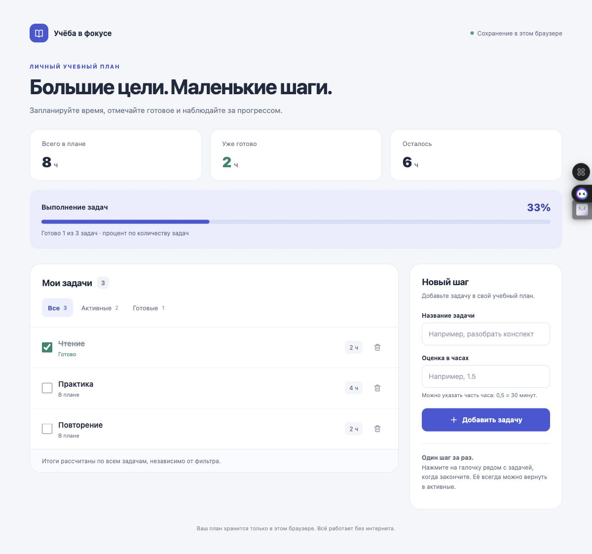
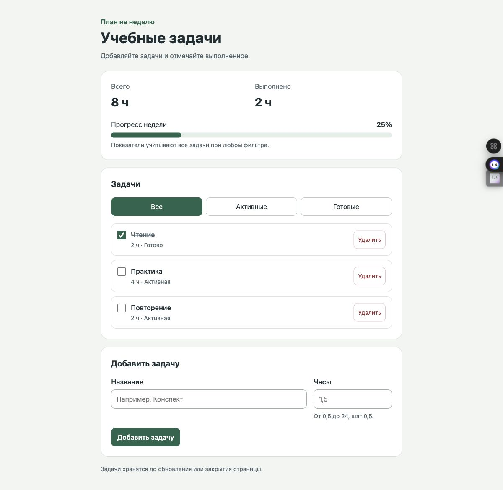

# Подтверждения проверок

- [Действия и наблюдения в Chrome](browser-checks.json): исходная v1, исходная v2, исправленная v1.
- [Проверка исходников и SHA-256](static-checks.json).
- [Модель, обращения и время ответов](process-metadata.json).
- [Первая редакция спецификации до уточнения](spec-initial.zip).

Исходная v1 показывает 33% вместо 25%:

Исходная v2 показывает 25%:

Скриншоты сделаны в реальном Chrome. Плавающие значки справа принадлежат расширениям браузера, а не трекерам.
